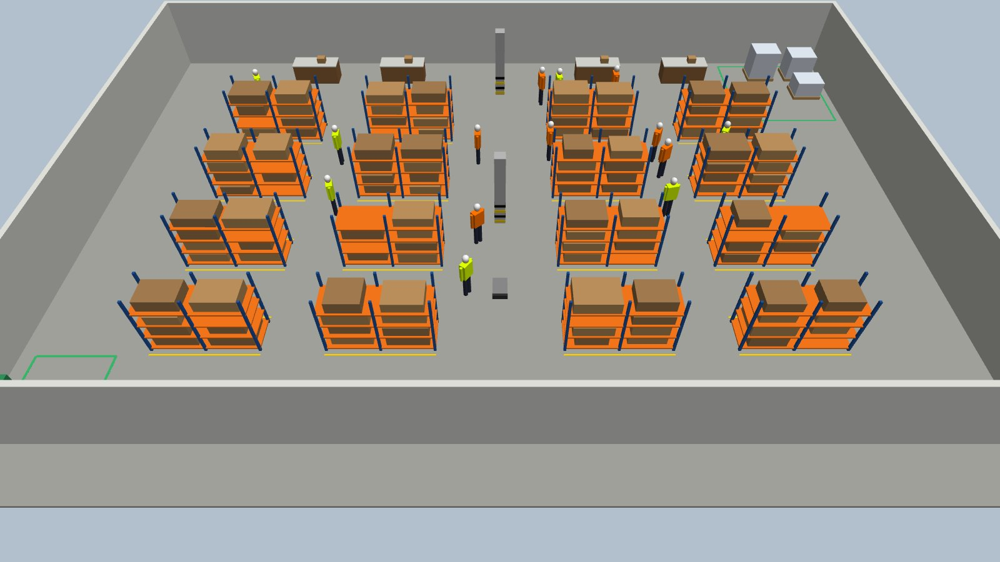
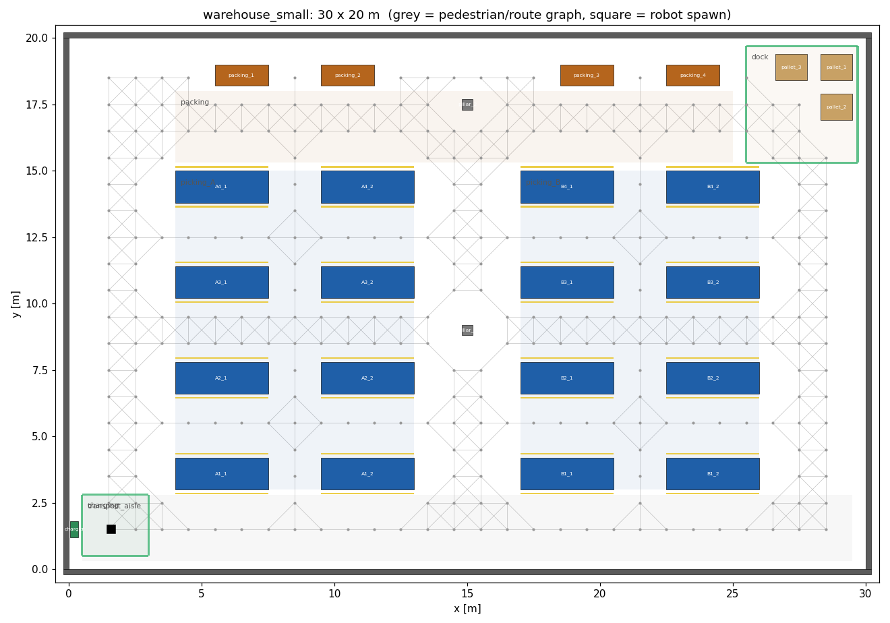
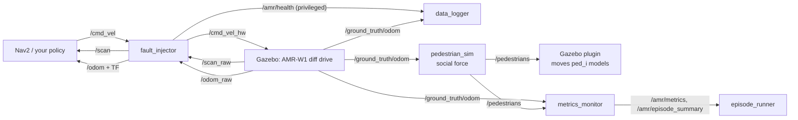
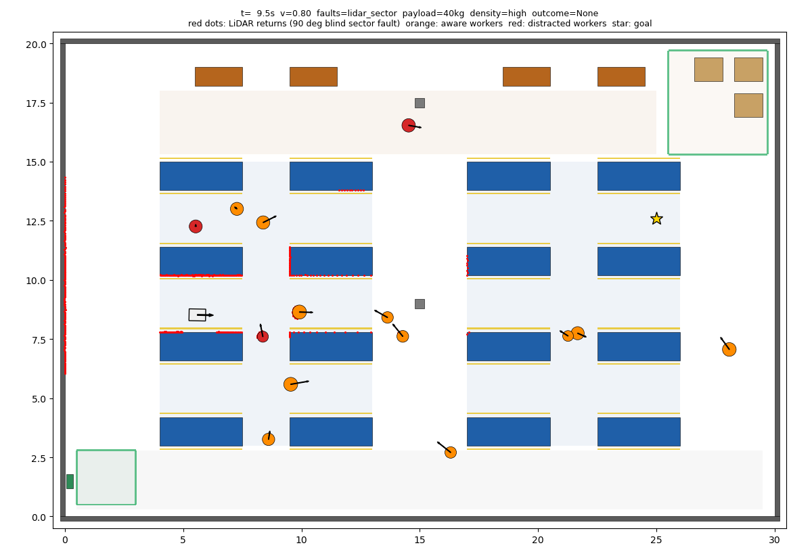

# warehouse-amr-sim

A simulation test bed for **AMR navigation among warehouse workers under robot degradation**. We built it to
evaluate two research proposals:

* **A1: Health-conditioned RL navigation among humans.** A teacher–student RL policy that stays safe
  around people when motors or sensors are degraded.
* **A7: JEPA-style LiDAR world model.** Predicts future scans from commanded motion, payload and health,
  slows the robot down early, and uses prediction error as a trust meter.

Both need the same things: a warehouse with aisles and cross-aisles, workers, a differential-drive AMR with
a 2D LiDAR, **fault injection at the correct interfaces**, privileged ground truth (health, future scans) and
**fixed metric definitions**. This repo provides all of these in two simulators that share one source of truth:

| | Gazebo Classic + ROS 2 Humble | Fast 2D simulator (pure Python) |
|---|---|---|
| Use for | Nav2 baseline, validation, demos, Gazebo datasets | RL training (A1), large datasets (A7), quick experiments |
| Speed | real time | about 30x real time per CPU core (10 Hz control) |
| Interface | ROS 2 topics / services | `WarehouseSim2D` and Gymnasium env `WarehouseNav-v0` |

The world layout, robot parameters, fault models, worker model and metrics are the same Python code
(`amr_sim_core`) in both simulators.



**Project status, screenshots and the work plan for Saleh and Basant: [docs/PROJECT_STATUS_AND_PLAN.md](docs/PROJECT_STATUS_AND_PLAN.md)**



## Contents

```
src/
  amr_sim_core/        shared models + 2D simulator + Gymnasium env (ROS package AND pip package)
    amr_sim_core/data/worlds/warehouse_small.yaml   <- the warehouse (single source of truth)
    amr_sim_core/data/robot/amr_w1.yaml             <- the robot (single source of truth)
    amr_sim_core/data/scenarios/*.yaml              <- training / evaluation / data-generation scenarios
  amr_description/     URDF/xacro of AMR-W1 (diff drive, 360 deg LiDAR, IMU, payload deck)
  warehouse_world/     generated Gazebo world + Nav2 map (do not edit by hand, see docs/WORLD.md)
  amr_gazebo_plugins/  C++ world plugin that moves the worker models in Gazebo
  amr_interfaces/      messages: HealthState, Pedestrian, PedestrianArray
  amr_sim_nodes/       fault_injector, pedestrian_sim, metrics_monitor, data_logger, episode_runner
  amr_bringup/         launch files, Nav2 params, RViz configs
examples/              baseline evaluation, A7 dataset generation, A1 PPO training
docs/                  ROBOT.md, WORLD.md, FAULTS_AND_METRICS.md, RESEARCH_MAPPING.md
```

## Data flow in Gazebo



## Install

Tested on **Ubuntu 22.04, ROS 2 Humble, Gazebo 11 (Classic)**.

```bash
sudo apt install ros-humble-desktop ros-humble-gazebo-ros-pkgs ros-humble-navigation2 ros-humble-nav2-bringup \
                 ros-humble-xacro ros-humble-teleop-twist-keyboard python3-colcon-common-extensions
pip install --user "gymnasium>=0.29,<1.0"            # 2D simulator / RL env

git clone https://github.com/salehNassar/warehouse-amr-sim.git ~/warehouse-amr-sim && cd ~/warehouse-amr-sim
source /opt/ros/humble/setup.bash
colcon build --symlink-install
source install/setup.bash
```

Without ROS (2D simulator only): `pip install -e "src/amr_sim_core[gym,viz]"`.

## Run

### Gazebo: world, robot and workers

```bash
ros2 launch amr_bringup sim.launch.py                          # Gazebo GUI + RViz
ros2 run teleop_twist_keyboard teleop_twist_keyboard          # drive the robot (/cmd_vel)

# options: scenario:=a1_train density:=high payload_mass:=40 gui:=false rviz:=false log_data:=true seed:=3
```

### Gazebo + Nav2 baseline

```bash
ros2 launch amr_bringup nav2_sim.launch.py                     # send a "2D Goal Pose" in RViz
# automatic evaluation: random start/goal/faults/payload/density per episode -> CSV
ros2 run amr_sim_nodes episode_runner --ros-args -p scenario:=a1_eval_heldout -p episodes:=50 \
     -p output:=~/amr_results/nav2_heldout.csv
```

### Inject faults at runtime

```bash
ros2 param set /fault_injector wheel_gain_left 0.5          # left wheel loses 50 % speed gain
ros2 param set /fault_injector cmd_latency 0.3              # 300 ms command delay
ros2 param set /fault_injector lidar_dropout_rate 0.3       # 30 % of beams lost
ros2 param set /fault_injector torque_gain 0.4              # weaker motors -> longer braking (esp. with payload)
ros2 service call /fault_injector/resample std_srvs/srv/Trigger     # random faults from the scenario
ros2 service call /fault_injector/set_nominal std_srvs/srv/Trigger
ros2 topic echo /amr/health                                 # true (privileged) health state
ros2 topic echo /amr/metrics                                # live collision / near-miss metrics
```

### Fast 2D simulator / Gymnasium

```python
import gymnasium as gym, amr_sim_core          # registers WarehouseNav-v0
env = gym.make("WarehouseNav-v0", scenario="a1_train", privileged=True)   # privileged = teacher obs
obs, info = env.reset(seed=0)                   # obs: scan, goal, velocity, last_action, peds, payload, health
obs, r, term, trunc, info = env.step(env.action_space.sample())
info["health"]                                  # true degradation vector (always in info, e.g. for distillation)
```

```bash
python3 examples/evaluate_baselines_2d.py --episodes 20         # path follower +/- protective field / TTC
python3 examples/generate_a7_dataset.py --episodes 200 --out ~/amr_datasets/a7_2d --bev
python3 examples/train_ppo.py --privileged --timesteps 3000000 --n-envs 8 --out runs/teacher   # needs SB3
python3 -m pytest src/amr_sim_core/test -q                     # unit tests
```



## Scenarios

| scenario | purpose | faults | severity | workers | payload |
|---|---|---|---|---|---|
| `nominal` | sanity checks, Nav2 tuning | none | - | medium | 0 kg |
| `a1_train` | A1 training distribution | wheel_gain, cmd_latency, lidar_dropout (1 at a time) | 0.0-0.6 | low/med/high, 20 % distracted | 0-60 kg |
| `a1_eval_heldout` | A1 held-out evaluation | + torque_loss, lidar_sector; up to 2 combined | 0.6-0.9 | low/med/high | 0-60 kg |
| `a7_data` | A7 world-model data | all 7 types, up to 2, **onset 0-30 s into the episode** | 0.0-0.9 | none to high | 0-60 kg |
| `a7_shift_humans` | A7 distribution shift (trust meter) | none | - | high, all distracted, fast | 0-60 kg |

Add a scenario by copying a YAML in `src/amr_sim_core/amr_sim_core/data/scenarios/`.

## Main topics (Gazebo)

| topic | type | notes |
|---|---|---|
| `/cmd_vel` | geometry_msgs/Twist | **input**: your policy / Nav2 |
| `/scan` | sensor_msgs/LaserScan | 720 beams, 360 deg, 10 Hz, **after** sensor faults (`inf` = no return) |
| `/odom` (+TF odom->base_footprint) | nav_msgs/Odometry | wheel odometry **after** encoder faults |
| `/imu` | sensor_msgs/Imu | 100 Hz |
| `/scan_raw`, `/odom_raw`, `/cmd_vel_hw` | | before/after the fault layer (for analysis) |
| `/amr/health` | amr_interfaces/HealthState | **privileged** true health + normalised vector |
| `/ground_truth/odom` | nav_msgs/Odometry | **privileged** ground-truth pose/twist (world = map frame) |
| `/pedestrians` | amr_interfaces/PedestrianArray | **privileged** worker states; `/pedestrians/markers` for RViz |
| `/amr/metrics`, `/amr/episode_summary` | std_msgs/String (JSON) | live and final episode metrics |

## Documentation

* [docs/PROJECT_STATUS_AND_PLAN.md](docs/PROJECT_STATUS_AND_PLAN.md): what is done, screenshots, plan and task split
* [docs/ROBOT.md](docs/ROBOT.md): AMR-W1 specification, frames, sensors, dynamics model
* [docs/WORLD.md](docs/WORLD.md): warehouse layout, zones, worker behaviour, editing or adding worlds
* [docs/FAULTS_AND_METRICS.md](docs/FAULTS_AND_METRICS.md): fault interfaces, severity mapping, health vector, metric definitions
* [docs/RESEARCH_MAPPING.md](docs/RESEARCH_MAPPING.md): how each step of the A1 and A7 proposals maps onto this repo

## Known limitations

* The **physical payload mass** in Gazebo is set when the robot spawns (`payload_mass:=`). The payload- and
  torque-dependent acceleration limit is applied in `fault_injector` (same model as the 2D sim) and can change
  at runtime.
* Gazebo workers are kinematic cylinders (r = 0.25 m) driven by the social-force node. They do not collide
  physically with each other, and a worker can push the robot.
* The 2D simulator has no wheel slip and no 3D effects. It has a single LiDAR plane, as in Gazebo.
* Nav2 parameters are a reasonable baseline, not a tuned competitor. Tune them before you report results.
* `examples/train_ppo.py` has been smoke-tested only. Reward weights and PPO hyperparameters are starting
  points, not tuned values.
