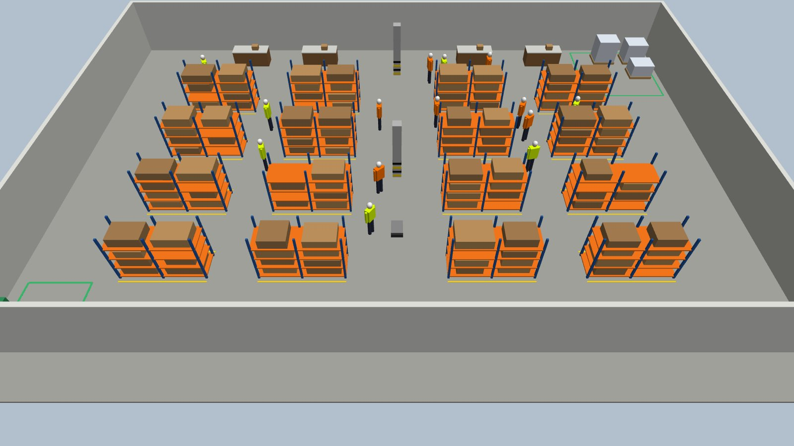
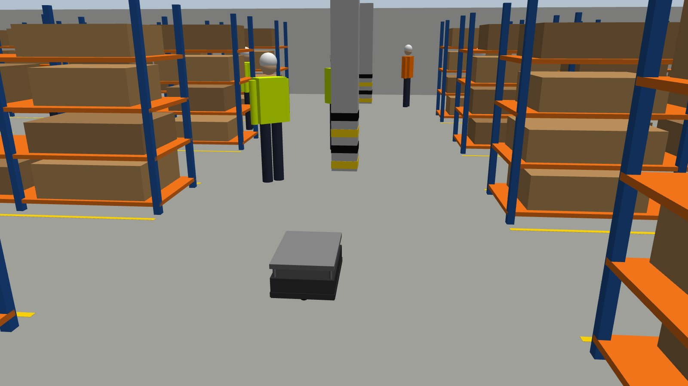
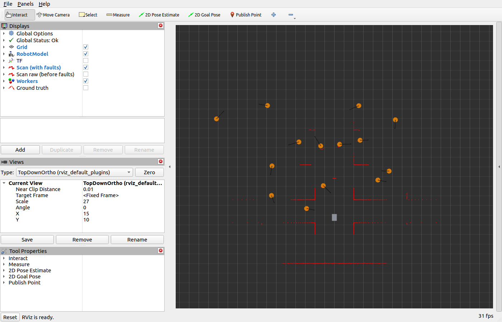

# Project status and work plan

*Saleh and Basant. Last updated 2026-11-23.*

This page covers three things: what exists now, what it looks like, and how we split the remaining work on
the two proposals:

* **A1: Health-conditioned RL navigation among humans** (teacher–student RL under robot faults)
* **A7: JEPA-style LiDAR world model** (predict future scans, slow down early, measure trust)

---

## 1. What we have now

Both proposals list "environment, fault injection and baselines ready" as **Milestone M1 (week 4)**.
That milestone is done: the shared test environment is built, tested and in this repo.

### The simulation in Gazebo

**Overview.** A 30 x 20 m warehouse. Two rack blocks, 2.4 m picking aisles, 2 m blind cross-aisles, a central
cross-aisle with pillars, packing stations at the back, a pallet dock (top right) and 14 workers in hi-vis vests
(high density).

**Close-up.** The AMR-W1 robot in the central cross-aisle. The 360° LiDAR sits in the slot between the
dark chassis and the grey payload deck. Workers walk and pick in the aisles ahead.

### What the robot perceives (RViz)

A top-down view of the same moment. The **grey box** is the robot. **Red dots** are LiDAR returns after the
fault layer: the rack ends of the cross-aisle, the bottom wall and nearby workers. **Orange discs** are workers,
with their velocity shown as black lines. Distracted workers, who do not yield to the robot, are drawn in red.

### What was built

| part | content | status |
|---|---|---|
| **World** | YAML layout → Gazebo world, Nav2 map and 2D simulator, all from one file | done |
| **Robot AMR-W1** | diff drive, 0.70 x 0.50 m, 360° LiDAR (720 beams, 10 Hz), IMU, payload deck 0–60 kg | done |
| **Workers** | social-force model, routes through aisles, picking stops, 20 % "distracted" | done |
| **Fault injection** | wheel-gain loss, torque loss, command latency, LiDAR dropout / blind sector / noise, encoder drift; severity 0–1, onset during an episode, combined faults | done |
| **Privileged signals** | true health vector (A1 teacher), ground-truth pose, worker states, future scans (A7 targets) | done |
| **Metrics** | collision, near-miss (< 0.5 m), success, time, path length, collision speed; same code in both simulators | done |
| **Baselines** | Nav2 (Gazebo), path follower + fixed protective field, reactive TTC rule | done |
| **Tooling** | Nav2 episode runner → CSV; data logger → .npz; Gymnasium env `WarehouseNav-v0`; A7 dataset generator; PPO / RecurrentPPO training script; 21 unit tests | done |
| **Docs** | README, ROBOT, WORLD, FAULTS_AND_METRICS, RESEARCH_MAPPING | done |

### What was checked

* All 7 ROS 2 packages build. All 21 unit tests pass.
* Gazebo runs at real-time factor 1.0 on this laptop, with 14 workers.
* Fault behaviour in Gazebo matches the model:
  * left wheel gain 0.4 → the robot curves left by 1.83 rad in 3 s (theory ≈ 1.64 rad plus deceleration);
  * 0.4 s command latency → motion starts after 0.5 s;
  * 50 % dropout plus a 90° blind sector → 663 → 244 valid beams.
* Workers are visible in the LiDAR.
* Nav2 completed real episodes through the episode runner. A LiDAR-dropout episode ended in a rack collision,
  which is exactly the kind of failure A1 studies.
* The 2D simulator runs at about 300 steps/s per core (30x real time). The PPO teacher, RecurrentPPO and the
  evaluation mode run end to end (smoke test only, not trained).

### Known limitations

* The physical payload in Gazebo is fixed when the robot spawns. The braking/acceleration effect of load and
  torque loss is modelled in the fault layer and *can* change at runtime.
* Gazebo workers are kinematic cylinders. They can push the robot, and they do not collide with each other physically.
* Nav2 parameters are a reasonable default, not tuned. They need tuning before we compare against Nav2.
* The laptop has **no GPU and about 5 GB RAM**. Real RL training and JEPA training need a GPU machine or a server.

---

## 2. Who does what (suggested split; swap the names if you prefer)

| | **Saleh** | **Basant** |
|---|---|---|
| Lead | **A1**: RL policy (teacher, student, RL baselines, safety filter) | **A7**: world model (dataset, predictors, risk head, trust meter) |
| Owns in the repo | `amr_sim_core/gym_env.py`, `examples/train_ppo.py`, new `a1/` folder | `examples/generate_a7_dataset.py`, `representations.py`, new `a7/` folder |
| Shared | Nav2 tuning, Gazebo validation, second warehouse layout, paper figures, weekly review |

Why this split works: the two tracks share the environment but not the model code, so we rarely edit the
same files. A7 can later feed A1: the trust meter could become an extra input or a fallback trigger for the
A1 policy. That link is an optional stretch goal, not a dependency.

---

## 3. Plan (12 weeks from now; we start at the proposals' week 5)

### Week 1: shared kick-off (both)

- [ ] Basant: clone, build and run (`README → Install`). Both of us drive the robot and try every fault type once.
- [ ] Agree on and freeze the shared settings: near-miss distance **0.5 m**, train / held-out severity split
      **0.6**, densities **4 / 8 / 14**, control period **0.1 s**, number of seeds (suggest **5**).
- [ ] Focused literature check of the closest work (novelty), split between us:
      A1 → RADAR-BPO, dynamic safety shield (L4DC 2025), Arena-Rosnav, fault-tolerant legged RL;
      A7 → LeWorldModel, Point-JEPA, AD-L-JEPA, AD-LiST-JEPA, WOLF.
- [ ] Find GPU compute (lab server, university cluster or Colab) and test the 2D sim there.
- [ ] Set up GitHub Issues from this plan, one issue per checkbox.

### A1 track (Saleh)

| week | task | output |
|---|---|---|
| 1–2 | Pilot runs: domain-randomised PPO and the privileged teacher on `a1_train`; tune reward weights and PPO settings until the teacher reaches a high success rate | working teacher, fixed training budget |
| 2–3 | Train teacher + DR-PPO + RecurrentPPO, 5 seeds each, same budget | trained baselines |
| 3–5 | **Student**: GRU encoder over observation/action history, DAgger distillation from the teacher, optional auxiliary health-estimation loss | student policy (the method) |
| 5–6 | Safety-filter baseline: CBF-style filter on PPO commands; document assumptions | safety-filter comparison |
| 6–8 | Evaluation: `a1_eval_heldout` (severity 0.6–0.9, combined faults), 3 densities, 5 seeds; curves of collision / near-miss vs severity; ablations (randomisation, history, distillation) | results tables and figures |
| 8–9 | Gazebo check: wrap the best policies as a ROS node (`/scan`, `/odom`, goal → `/cmd_vel`) and run `episode_runner` | second-simulator validation |
| 9–12 | Paper writing (method, experiments) | A1 manuscript draft |

### A7 track (Basant)

| week | task | output |
|---|---|---|
| 1–2 | Generate the dataset: `a7_data` (~2,000 episodes), `a7_shift_humans`, nominal; fix representation (64x64 BEV or polar) and horizons (e.g. 0.5 / 1 / 2 s) | dataset and dataloader |
| 2–3 | Baselines: constant-velocity scan extrapolation, ConvLSTM future-grid predictor | forecasting baseline results |
| 3–6 | **JEPA predictor**: encoder plus context-conditioned latent predictor (cmd, payload, health), SIGReg-style regulariser; check for collapse | trained world model |
| 6–7 | Context ablation: with vs without payload/health context | ablation table |
| 7–9 | Risk head (predicted clearance / TTC) plus predictive slowdown rule; closed-loop comparison with the fixed protective field and TTC in the 2D sim, at equal throughput | safety–throughput results |
| 9–10 | Trust meter: latent surprise, threshold on nominal validation runs (conformal optional); AUROC for faults (fault onset in `a7_data`), human shift and a **new layout** | monitoring results |
| 10–12 | Paper writing | A7 manuscript draft |

### Shared infrastructure tasks (whoever is free first)

- [ ] **Second warehouse layout** (e.g. wider aisles, different block arrangement) for the A7 "new layout" shift and for A1 generalisation.
- [ ] **Tune Nav2** so it is a fair baseline, then run `episode_runner` on `nominal` and `a1_eval_heldout` (50 episodes each).
- [ ] Optional **combined demo**: the A7 trust meter triggers a conservative fallback for the A1 policy.
- [ ] Optional stretch goals: ONNX export and Jetson latency for both models.

### Milestones

| when | milestone |
|---|---|
| end of week 1 | shared settings frozen, literature check done, compute available |
| end of week 3 | A1 teacher and baselines trained · A7 dataset and baselines done |
| end of week 6 | A1 student trained · A7 JEPA predictor trained |
| end of week 9 | all evaluations done (including Gazebo checks and the trust meter) |
| end of week 12 | both manuscript drafts |

---

## 4. How we work together

* **Git:** `main` always builds and passes tests. Each task gets its own branch (`a1/student-gru`, `a7/convlstm`,
  ...) and a pull request with a one-line test note. The other person reviews quickly.
* **Do not** commit datasets, checkpoints or result CSVs (`.gitignore` blocks them). Put them in the shared Drive
  folder under `results/<track>/<date>_<experiment>/`, and include the scenario name, seed and git commit hash.
* **Before any change to shared code** (`world.py`, `faults.py`, `metrics.py`, scenario YAMLs), tell the other
  person. These files define both papers' experiments.
* **Weekly 30-minute sync:** what was done, what is blocked, and figures to review.
* **Run the tests before pushing:** `python3 -m pytest src/amr_sim_core/test -q`.
